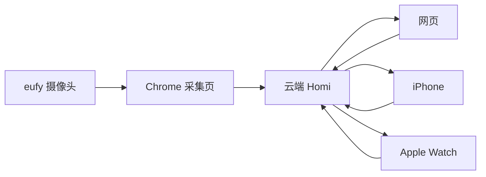

# 留灯 · Porchlight

留灯是一个少打扰的智能看护助手：摄像头采集场景，云端结合短期计划和长期记忆整理事件、提醒与日报；网页、iPhone 和 Apple Watch 查看同一份云端信息。

本仓库是 2026-10-17 的代码与交互交接整理，**不是声称所有代码均已部署的线上镜像**。

## 从哪里开始

| 目录 | 内容 |
|---|---|
| `apple/Liudeng.xcodeproj` | iPhone 与 watchOS 的 SwiftUI 工程 |
| `cloud/src` | React 网页、摄像头采集与共用业务逻辑 |
| `cloud/server` | Node 云端：鉴权、推送、事件、计划、记忆、模型代理 |
| `design/app` | 手机交互稿，含 iPhone 13 mini / OPPO Find X8 双机预览 |
| `design/watch` | Apple Watch S9 双尺寸交互稿与开发文档 |
| [交互与功能](docs/interactions.md) | 三端页面、操作、数据流与实现边界 |
| [运行与交接](docs/development.md) | 配置、编译、联调和部署说明 |
| [版本状态](docs/status.md) | 来源、安装状态、缺失依赖与待验收项 |
| [交接版 API](docs/api-handover.md) | 后端接口原始交接说明；以实际服务为准 |

## 架构



当前手表直接连接云端，不经 WatchConnectivity 转发；与早期设计建议不同。手机、手表接收周期更新的 JPEG 画面，约五秒显示一次，不是带音频的连续视频。

## 快速启动

网页与云端建议使用 Node.js 22.6+，在 `cloud/` 执行：

```sh
npm ci
cp .env.example .env
# 在本机填写 .env；摄像头参数另存 eufy.local.json
npm run dev
```

网页开发入口 `http://localhost:5181`，云端 `http://127.0.0.1:8787`。eufy 采集还需要自行放入主办方提供的 SDK，见 [SDK 说明](cloud/public/sdk/README.md)。

Apple 工程：打开 `apple/Liudeng.xcodeproj`，配置自己的签名 Team，填写两份 Cloud 模型中的 HTTPS 云端地址，再选择 `Liudengphone` 或 `Liudeng Watch App` Scheme 编译。iPhone 界面按 16 Pro Max 的 440×956 pt 适配，使用系统安全区和动态布局。

交互原型：直接用浏览器打开 `design/app/devices.html` 或 `design/watch/留灯-Apple-Watch-S9-双尺寸交互.html`。原型使用演示数据，不能替代原生 App 或真实云端。

## 项目核心

先展示真实画面和三端同步，再展示事件、计划和记忆。核心是结合用户安排判断哪些变化值得关注，一般活动只记录，需要关注时才提醒；不是让用户持续盯着监控。

## 数据与依赖

仓库不包含访问密码、AI Key、AWS 凭证、设备 Token、实际采集数据、签名证书或个人 Xcode 设置。第三方 eufy SDK 的二进制脚本不在本次归档中，需要从有权使用的主办方资料补齐。本次未为团队代码或第三方资源新增开源许可证。
