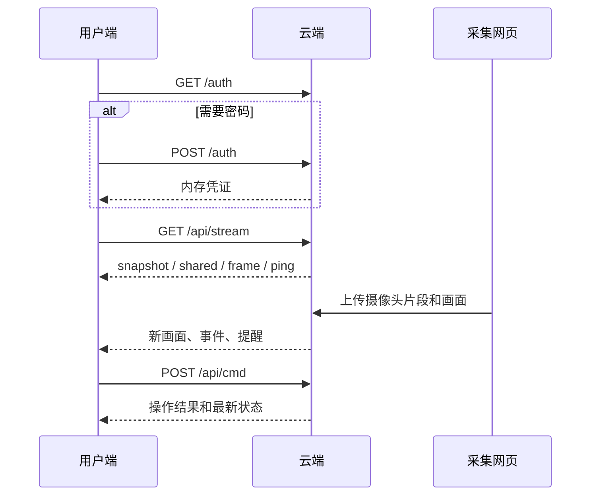

# 三端交互与实现边界

## iPhone

底部四页：此刻、计划、记忆、对话。

- 此刻：当前摄像头画面、最近事件、提醒；打开今天查看事件与日报，点击画面查看大图并请求快照。
- 计划：新增或编辑文字、时间范围、启用状态。
- 记忆：查看、修改长期习惯及启用状态。
- 对话：经云端调用模型；将对话转成计划或记忆须用户在表单中确认。
- 登录：服务器明确不要求密码时自动连接；要求密码时由用户输入，凭证仅放内存。
- 恢复：前台自动重试；四十秒无推送心跳重连；超过十五秒没有新画面，取消实时标识；后台暂停。

布局沿用紫白简洁版。设计原型最初适配 13 mini 和 OPPO，当前原生手机真机为 16 Pro Max；仓库没有可安装的 OPPO / Android 工程。

## Apple Watch S9

首页显示云端状态、缩略画面、最近事件、提醒及启用计划；点击画面打开详情，支持“现在看一眼”；提醒可确认已读。源码名称为“留灯”，可在安装后测试“嘿 Siri，打开留灯”。改名不等于 Siri 识别已验证。

手表直接连接 HTTPS 云端，与手机共享服务但不依赖手机 App 转发。锁屏、后台运行受 watchOS 限制。显示名称和最新重连修复已进入源码并编译，尚未成功安装到手表。

## 网页与云端

网页包含简洁主页和 `?dev=console` 调试台。采集页通过 eufy SDK 开流，向云端发送画面及片段；云端统一维护状态，通过 SSE 推送给查看端。同一时刻只保留一个采集端。

## 不应混淆

- HTML 交互稿的语音、对讲入口可能是演示；原生 App 未实现独立 ASR、双向对讲或完整视频播放器。
- 当前没有 APNs 锁屏推送完整链路。
- 画面曾在三端真实显示，不代表网络永不掉线。Mac 采集页必须保持开启且电脑不休眠。
- 旧设计文档的接口建议不作为现有 API 合同；云端源码及 API 文档优先。
